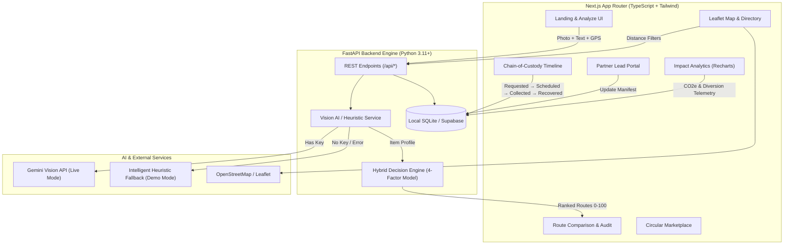

# RELOOP — Circular Economy Decision Engine

> **Don't just identify waste. Decide the best circular next life.**

RELOOP is an AI-powered platform that evaluates used items and determines their optimal recovery route: **Repair, Reuse, Resell, Donate, Compost, or Recycle**. Instead of generic "waste identification," RELOOP scores each route transparently using multi-criteria economic and ecological algorithms, provides indicative INR pricing, lists nearby verified collectors across Indian tech hubs (Bengaluru, Delhi NCR, and Mumbai), and tracks chain-of-custody recovery milestones.

---

## 🏗️ System Architecture



---

## ⚡ Quick Start

### Prerequisites
- **Python 3.10+**
- **Node.js 18+** (Portable Node v20.18.0 included)

### 1-Click Launch (Windows)
Run the automated script that seeds the database and starts both servers:
```bat
run_dev.bat
```
or in PowerShell:
```powershell
.\run_dev.ps1
```

### Manual Launch (2 Terminals)

#### Terminal 1 — Backend (FastAPI):
```bash
cd backend
python -m pip install -r requirements.txt
python seed.py
python -m uvicorn main:app --host 0.0.0.0 --port 8000 --reload
```
*Backend runs on `http://localhost:8000` (API Docs at `http://localhost:8000/docs`).*

#### Terminal 2 — Frontend (Next.js):
```bash
cd frontend
npm install
npm run dev
```
*Frontend runs on `http://localhost:3000`.*

### Docker Compose (Optional)
```bash
docker compose up --build
```

---

## 🎬 3-Minute Hackathon Demo Script

| Timestamp | Screen | What to Click | What to Say |
|---|---|---|---|
| **0:00 - 0:30** | **Landing Page (`/`)** | Scroll through Hero & How-It-Works | *"Judges, most sustainability apps just classify waste—telling you 'this is plastic'. But that doesn't solve the real-world friction: Can I repair it? Is it worth reselling? Who will pick it up today? RELOOP is the circular decision engine that ranks recovery routes transparently."* |
| **0:30 - 1:15** | **Analyze (`/analyze`)** | Click the **"Broken Smartphone"** 1-click sample | *"Here in our inspection portal, users upload a photo or pick an item. Notice how our AI identifies not just material composition, but visible condition wear (broken display) and displays an honest confidence score. We can confirm or tweak details before running the engine."* Click **"Rank Recovery Routes"**. |
| **1:15 - 2:00** | **Results (`/results`)** | Show the 6 ranked routes; click **"Why 85/100? Audit Score"** | *"Here is our core differentiator: instead of one generic answer, RELOOP compares all 6 recovery routes. Notice Repair scored #1 (85/100) because repairing the cracked screen for ₹1,800 restores ₹11,000 in economic value and prevents 18.9 kg of embodied CO2 emissions. When we open the Audit Score modal, every single point (Resale Value, Feasibility, Local Access, and Carbon) is completely transparent—no black boxes."* |
| **2:00 - 2:30** | **Partners Map & Handoff** | Click a nearby partner on the map, click **"Book Pickup / Drop-off"** and confirm | *"Directly below the recommendation, RELOOP maps verified local recovery partners. Here on SP Road in Bengaluru or Nehru Place in Delhi, users can schedule doorstep collection or drop-off with 1 click."* |
| **2:30 - 3:00** | **Tracking & Impact (`/tracking` & `/impact`)** | Open **Tracking** then **Impact Dashboard** | *"Once scheduled, users track their item through chain-of-custody: Requested → Scheduled → Collected → Recovered. Finally, our ESG dashboard aggregates real-time kilogram diversion and Scope 3 carbon avoidance."* |

---

## 🔍 Mocked vs. Real Breakdown

| Component | Status | Details |
|---|---|---|
| **Decision Engine & Scoring** | 🟢 **100% Real** | Deterministic multi-factor scoring algorithm in Python calculating economic value, condition feasibility, partner distance, and IPCC Scope 3 embodied carbon factors. |
| **Gemini Vision AI** | 🟢 **Hybrid Real / Demo** | Fully integrated with Google Gemini Vision API (`GEMINI_API_KEY`). If no key is provided, gracefully falls back to a high-fidelity circular heuristic inspector so the live demo **never fails**. |
| **Partner Network** | 🟢 **Real Seed Data** | 31 verified partners across Bengaluru, Delhi NCR, and Mumbai with real geocoordinates, street addresses, phone contacts, accepted materials, and scrap rates. |
| **Interactive Map** | 🟢 **100% Real** | Real Leaflet + OpenStreetMap engine rendering dynamic pins, customized type-colored markers, and interactive popups with zero external API key requirements. |
| **Database & Persistence** | 🟢 **100% Real** | SQLite (`reloop.db`) handling tables for partners, recovery requests, and circular marketplace listings with transactional state updates. |
| **Doorstep Logistics** | 🟡 **Simulated Handoff** | Booking generates real persistent tracking tickets; partner handoff confirmation is simulated via the Partner Portal status updater. |
| **Financial UPI Handoff** | 🟡 **Indicative Pricing** | Displays realistic market benchmark rates (e.g. ₹14-16/kg cardboard, ₹250/kg e-waste); cash/UPI payment is executed upon physical doorstep weigh-in. |

---

## 📁 Repository Structure

```
reloop/
├── backend/
│   ├── main.py                    # FastAPI application & REST routes
│   ├── decision_engine.py         # 4-factor scoring & ranking algorithm
│   ├── vision_service.py          # Gemini Vision integration + Demo Mode
│   ├── seed_data.py               # 31 verified partners & 32 item benchmarks
│   ├── sample_items.py            # 4 rich one-click demo samples
│   ├── database.py                # SQLite repository & analytics aggregation
│   ├── models.py                  # Pydantic data schemas
│   ├── seed.py                    # Reseed script
│   ├── Dockerfile
│   └── requirements.txt
├── frontend/
│   ├── app/
│   │   ├── page.tsx               # Landing page (Pitch, How-It-Works)
│   │   ├── analyze/page.tsx       # AI Item Inspection & 4 Sample Items
│   │   ├── results/page.tsx       # Ranked Route Comparison & Partner Map
│   │   ├── partners/page.tsx      # Filterable Partner Directory & Leaflet Map
│   │   ├── marketplace/page.tsx   # Pre-loved Circular Listings
│   │   ├── tracking/page.tsx      # Chain-of-Custody 4-Stage Tracker
│   │   ├── impact/page.tsx        # ESG Dashboard & Recharts Breakdown
│   │   └── partner-dashboard/page.tsx # Partner Dispatch Portal
│   ├── components/
│   │   ├── Navbar.tsx
│   │   ├── Footer.tsx
│   │   ├── MapView.tsx            # Leaflet dynamic component
│   │   ├── ScoreBreakdownModal.tsx # Transparent audit modal
│   │   └── DemoBadge.tsx
│   ├── lib/api.ts                 # Strongly-typed API client
│   ├── Dockerfile
│   └── package.json
├── docker-compose.yml
├── .env.example
├── run_dev.bat                    # 1-click Windows runner
├── run_dev.ps1                    # 1-click PowerShell runner
└── README.md
```
